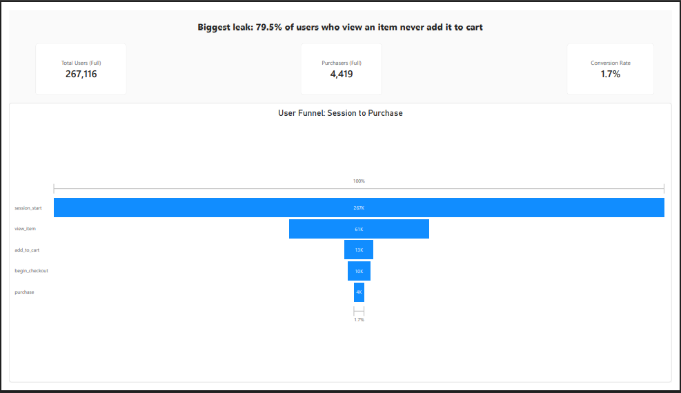
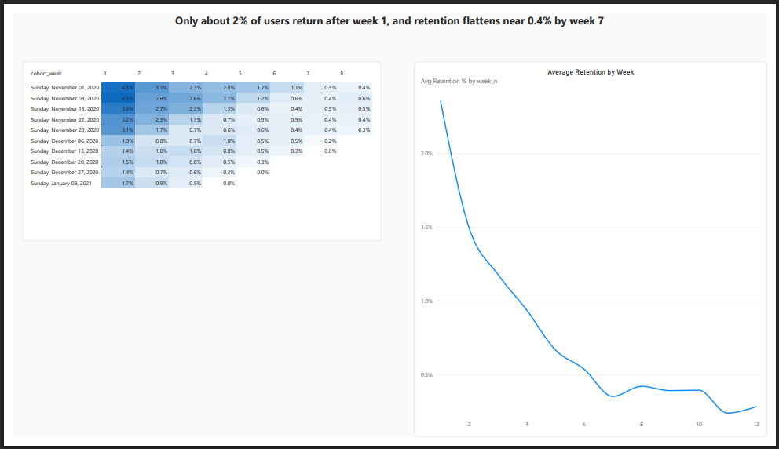
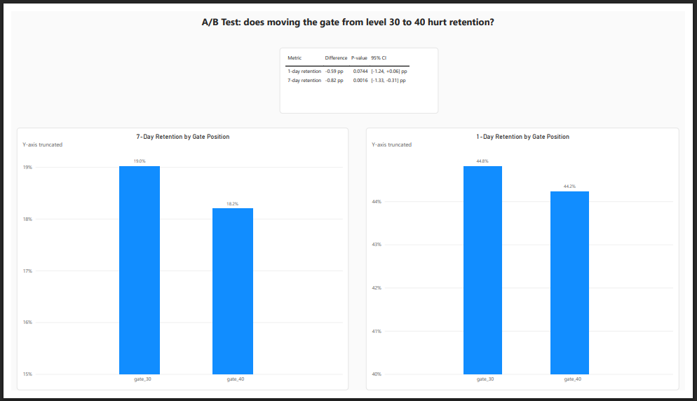

# Funnel Analytics + A/B Testing

**Where do users drop off, which change could fix it, and did the experiment really work?**

One product question, three layers: **funnel → retention → experiment**.

## Key findings

- **Funnel:** Only 1.7% of users who start a session buy anything. The biggest leak is view item → add to cart (79.5% drop-off). Among users who reach checkout, 54.5% still don't purchase.
- **Retention:** About 2.4% of users return in week 1, and retention flattens near 0.4% by week 7. November cohorts retained better (3.1% to 4.5% in week 1) than December and January cohorts (1.4% to 2.0%).
- **A/B test:** Moving the gate from level 30 to level 40 lowered 7-day retention by 0.82 percentage points (19.02% → 18.20%, p = 0.0016, 95% CI [-1.33, -0.31] pp). 1-day retention showed no significant change (p = 0.0744). **Recommendation: keep the gate at level 30.**

## Dashboard





## Data

| Layer | Dataset | Notes |
|---|---|---|
| Funnel and retention | GA4 obfuscated e-commerce sample (BigQuery public data) | Google Merchandise Store events, Nov 2020 to Jan 2021 |
| A/B test | Cookie Cats (Kaggle, "Mobile Games A/B Testing - Cookie Cats") | 90,189 players, `gate_30` vs `gate_40` |

The two datasets come from different products. The GA4 data has no real experiment, so the A/B test uses a separate public experiment dataset. Findings from one do not apply to the other.

## Method

**1. Funnel (SQL, BigQuery)**
- User-level funnel: session_start → view_item → add_to_cart → begin_checkout → purchase (267,116 → 61,252 → 12,545 → 9,715 → 4,419 users).
- Session-level funnel (360,129 sessions, 1.35% purchase rate), which confirms the user-level pattern.
- Event sequences: 73.7% of sessions only view an item, and 3.9% go from view straight to checkout without adding to cart, so the funnel is not strictly linear.

**2. Retention (Python)**
- Weekly cohorts by first visit date, shown as a cohort heatmap and an average retention curve. The last four cohorts are excluded from the average because their weeks are incomplete.

**3. A/B test (Python)**
- Sample ratio mismatch check on group sizes.
- Two-proportion z-test and chi-square test on 1-day and 7-day retention, with 95% confidence intervals for the difference.
- Bootstrap (10,000 resamples) on 7-day retention: 95% CI [-1.32, -0.31] pp, and gate_40 was worse in 99.9% of resamples.
- Power analysis: about 24,657 users per group are needed to detect a 1 pp change. The test had about 45,000 per group.

**4. Excel A/B calculator**
- Enter visitors and conversions for A and B to get conversion rates, lift, z-score, p-value, confidence interval and a significant / not significant result. Validated against the Python output.

**5. Power BI dashboard**
- Three pages: funnel, retention heatmap, A/B result.

## Limitations

- The groups are slightly unbalanced (44,700 vs 45,489, SRM p = 0.0086). This is a mild flag, but worth noting.
- Retention is the only outcome in Cookie Cats. There is no revenue data, so the effect of the gate on monetization is unknown.
- The GA4 funnel counts users who fired each event during the whole period, not strict step order, and the sample covers only three months.
- The explanation for lower later retention (a later gate delays the natural break point) is a hypothesis, not something the data proves.
- The November vs December retention difference may reflect holiday traffic, which this analysis did not test.

## Repository structure

```
funnel-ab-testing/
├── sql/
│   ├── 01_funnel_dropoff.sql
│   ├── 02_session_funnel.sql
│   ├── 03_event_paths.sql
│   └── 04_retention.sql
├── notebooks/
│   ├── 01_retention.py
│   └── 02_ab_test.py
├── data/
├── excel/ab_calculator.xlsx
├── powerbi/funnel_ab_dashboard.pbix
├── images/
└── README.md
```

## How to reproduce

1. Run the SQL files in the BigQuery sandbox on `bigquery-public-data.ga4_obfuscated_sample_ecommerce` and export the results to `data/`.
2. Download `cookie_cats.csv` from Kaggle into `data/`.
3. `pip install pandas seaborn matplotlib scipy statsmodels`
4. Run `notebooks/01_retention.py` and `notebooks/02_ab_test.py`. Update the file paths at the top first.
5. Open the `.pbix` in Power BI Desktop and refresh the data sources.

## Tools

SQL (BigQuery), Python (pandas, seaborn, scipy, statsmodels), Excel, Power BI

## Author

Mohit | <LinkedIn URL> | <GitHub URL>